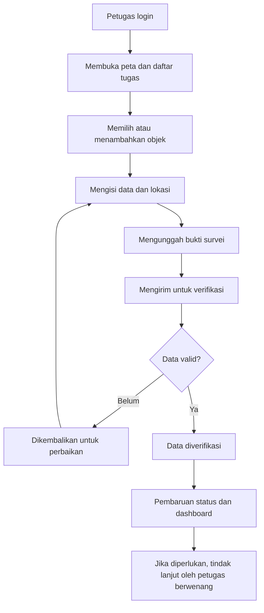
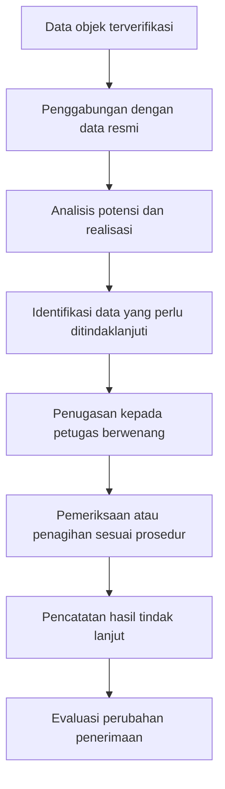
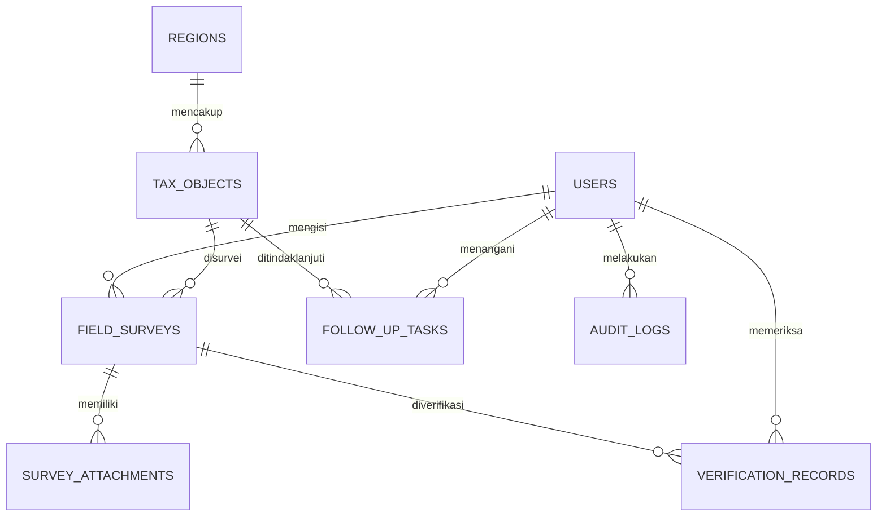

# PRD — PAD SmartMap Kotabumi

**Product Requirements Document**  
**Versi:** 1.0  
**Tanggal:** 20 Oktober 2026  
**Wilayah implementasi awal:** Kecamatan Kotabumi Selatan, Kabupaten Lampung Utara, Provinsi Lampung  
**Platform:** Aplikasi web responsif dengan peta digital GIS dan dashboard administrasi

---

## Ringkasan Produk

### Tujuan Produk

Membantu pemerintah daerah memetakan, memverifikasi, memantau, dan menganalisis data objek pajak secara geografis untuk mendukung optimalisasi Pendapatan Asli Daerah (PAD).

### Pengguna Utama

- Administrator sistem
- Petugas Bapenda
- Petugas pendataan lapangan
- Pimpinan atau pejabat yang memperoleh akses sesuai kewenangan

### Ringkasan Eksekutif

PAD SmartMap merupakan aplikasi Sistem Informasi Geografis (GIS) yang dirancang untuk membantu pengelolaan informasi potensi pajak daerah melalui visualisasi peta, pencatatan objek pajak, validasi hasil survei, pemantauan tindak lanjut, serta penyajian laporan dan dashboard.

Permasalahan yang ingin ditangani adalah kemungkinan adanya data objek pajak yang belum mutakhir, ketidaksesuaian data administrasi dengan kondisi lapangan, dan kesulitan melihat persebaran potensi pajak berdasarkan wilayah. Permasalahan tersebut masih harus dikonfirmasi melalui observasi, wawancara, dan pemeriksaan sistem yang sudah digunakan oleh pemerintah daerah.

Produk ini tidak dimaksudkan untuk menggantikan sistem perpajakan resmi. PAD SmartMap berfungsi sebagai alat bantu analisis dan pengawasan yang menggunakan data resmi yang diizinkan, dengan fokus awal pada Pajak Bumi dan Bangunan Perdesaan dan Perkotaan (PBB-P2).

## 1. Latar Belakang dan Permasalahan

### 1.1 Latar Belakang

Optimalisasi PAD tidak hanya bergantung pada penetapan tarif atau penambahan jenis pajak, tetapi juga pada kualitas pendataan, kepatuhan wajib pajak, ketepatan administrasi, dan efektivitas tindak lanjut. Data yang disajikan dalam bentuk tabel saja juga belum tentu cukup untuk menunjukkan konsentrasi objek pajak atau wilayah yang membutuhkan pendataan lebih lanjut.

Pemanfaatan GIS memungkinkan data objek pajak dihubungkan dengan lokasi geografisnya. Dengan pendekatan ini, petugas dapat melihat distribusi objek, mengidentifikasi data yang perlu diverifikasi, dan menyusun prioritas pekerjaan berdasarkan informasi yang tersedia.

### 1.2 Rumusan Masalah

1. Bagaimana memetakan persebaran objek pajak secara digital?
2. Bagaimana membantu petugas menemukan data objek pajak yang belum lengkap atau perlu diverifikasi?
3. Bagaimana menyajikan informasi potensi pajak dan realisasi penerimaan secara mudah dipahami?
4. Bagaimana mendokumentasikan tindak lanjut pendataan dan penagihan secara terstruktur?
5. Bagaimana mengukur kontribusi sistem terhadap efisiensi kerja dan optimalisasi PAD?

### 1.3 Hipotesis Solusi

Jika data objek pajak yang sah dapat diintegrasikan dengan peta digital dan alur kerja verifikasi, maka petugas diharapkan dapat melakukan pendataan secara lebih terarah, mengurangi ketidaksesuaian data, dan membantu pemerintah menentukan prioritas optimalisasi penerimaan.

Hipotesis tersebut perlu diuji melalui pilot project, bukan dianggap sebagai hasil yang sudah terbukti.

## 2. Visi, Misi, dan Tujuan Produk

### 2.1 Visi

Menjadi sistem pendukung pengambilan keputusan berbasis data geografis untuk membantu pemerintah Kabupaten Lampung Utara mengoptimalkan pendataan dan pengawasan potensi pajak daerah.

### 2.2 Misi

- Menyediakan pemetaan objek pajak yang terstruktur dan mudah dipahami.
- Mempermudah petugas dalam melakukan pendataan dan verifikasi lapangan.
- Menyediakan informasi potensi dan realisasi pajak berdasarkan data yang sah.
- Meningkatkan keterlacakan tindak lanjut dan kualitas laporan.
- Mendukung pengambilan keputusan yang lebih akurat, transparan, dan terukur.

### 2.3 Tujuan Produk

| ID | Tujuan | Indikator Keberhasilan |
|---|---|---|
| OBJ-01 | Memusatkan data objek pajak | Data yang diizinkan tersedia dalam satu sistem |
| OBJ-02 | Mempercepat verifikasi | Waktu rata-rata verifikasi dapat dibandingkan sebelum dan sesudah pilot |
| OBJ-03 | Meningkatkan kualitas data | Jumlah data tidak lengkap, duplikat, dan belum terverifikasi dapat diukur |
| OBJ-04 | Mempermudah pemantauan | Petugas dapat melihat status objek dan tindak lanjut |
| OBJ-05 | Mendukung optimalisasi PAD | Perubahan penerimaan yang terkait dengan tindak lanjut dapat dievaluasi |

Target numerik untuk masing-masing indikator akan ditetapkan setelah baseline diketahui. Jangan menetapkan angka peningkatan PAD tanpa data awal yang memadai.

## 3. Target Pengguna dan Pemangku Kepentingan

### 3.1 Administrator Sistem

Mengelola akun, peran pengguna, konfigurasi wilayah, referensi data, dan audit aktivitas. Administrator teknis tidak otomatis memiliki hak melihat seluruh informasi pajak.

### 3.2 Petugas Bapenda

Mengelola data sesuai kewenangan, memeriksa hasil verifikasi, memantau tindak lanjut, dan mengakses laporan perpajakan yang diizinkan.

### 3.3 Petugas Pendataan Lapangan

Melihat tugas yang diberikan, mencatat kondisi objek, mengunggah bukti survei, serta mengirim hasil verifikasi untuk ditinjau.

### 3.4 Pimpinan atau Pejabat Berwenang

Melihat ringkasan potensi, realisasi, kualitas data, dan perkembangan tindak lanjut berdasarkan tingkat akses yang diberikan.

### 3.5 User Persona

| Persona | Kebutuhan Utama | Kendala yang Ingin Diatasi |
|---|---|---|
| Petugas Bapenda | Data objek dan status tindak lanjut | Data tersebar di berbagai sumber |
| Petugas lapangan | Form pendataan yang praktis | Pencatatan berulang dan sulit melacak hasil survei |
| Pimpinan | Ringkasan yang mudah dipahami | Kesulitan melihat prioritas berdasarkan wilayah |
| Administrator | Pengaturan akses dan keamanan | Risiko akses yang tidak sesuai kewenangan |

Warga atau wajib pajak bukan pengguna utama pada MVP. Portal publik untuk melihat peta atau membayar pajak juga tidak termasuk dalam ruang lingkup awal.

## 4. Ruang Lingkup Produk

### 4.1 Fitur Wajib (MVP)

- **Autentikasi dan manajemen pengguna:** login, logout, pengaturan peran, dan pembatasan akses berdasarkan kewenangan.
- **Dashboard PAD:** ringkasan jumlah objek, status verifikasi, data belum lengkap, dan penerimaan resmi yang tersedia.
- **Peta digital GIS:** visualisasi objek pajak berdasarkan koordinat atau batas wilayah yang telah divalidasi.
- **Manajemen data objek:** tambah, lihat, ubah, pencarian, filter, dan penandaan kemungkinan duplikasi.
- **Verifikasi lapangan:** form kondisi objek, koordinat, foto bukti, catatan petugas, dan alur persetujuan.
- **Monitoring tindak lanjut:** status pemeriksaan, penugasan, penyelesaian, dan catatan tindak lanjut.
- **Laporan dan audit aktivitas:** rekap data, ekspor laporan, dan pencatatan aktivitas penting pengguna.

### 4.2 Fitur Lanjutan

- Integrasi API dengan sistem pemerintah yang diizinkan.
- Sinkronisasi data penerimaan secara berkala.
- Mode pendataan offline untuk petugas lapangan.
- Analitik spasial yang lebih mendalam.
- Notifikasi tugas dan pengingat tindak lanjut.
- Perluasan ke kategori pajak atau retribusi lain setelah kebutuhan dan kewenangannya divalidasi.

### 4.3 Fitur di Luar Ruang Lingkup

- Pembayaran pajak langsung dan pengelolaan transaksi keuangan.
- Penerbitan atau perubahan ketetapan pajak secara otomatis.
- Penetapan tarif atau sanksi oleh algoritma.
- Penggantian sistem perpajakan resmi.
- Pelacakan warga secara real-time.
- Prediksi pendapatan berbasis AI tanpa data historis yang memadai.
- Publikasi identitas wajib pajak atau nilai kewajiban individual kepada masyarakat umum.

## 5. Kebutuhan Fungsional

| ID | Kebutuhan Fungsional | Prioritas |
|---|---|---|
| FR-01 | Pengguna dapat login dan logout dengan aman | Must-have |
| FR-02 | Admin dapat membuat, mengubah, menonaktifkan, dan menetapkan peran akun | Must-have |
| FR-03 | Pengguna dapat melihat dashboard sesuai hak akses | Must-have |
| FR-04 | Petugas dapat melihat peta dan mencari objek pajak | Must-have |
| FR-05 | Petugas berwenang dapat menambahkan dan memperbarui data objek | Must-have |
| FR-06 | Sistem dapat menandai data tidak lengkap dan kemungkinan duplikat | Must-have |
| FR-07 | Petugas lapangan dapat mengirim hasil verifikasi dan bukti pendukung | Must-have |
| FR-08 | Petugas berwenang dapat menyetujui atau mengembalikan hasil verifikasi | Must-have |
| FR-09 | Pengguna berwenang dapat memantau status tindak lanjut | Must-have |
| FR-10 | Sistem dapat menghasilkan laporan berdasarkan periode dan wilayah | Must-have |
| FR-11 | Sistem mencatat perubahan data dan aktivitas penting | Must-have |
| FR-12 | Sistem dapat mengimpor data terstruktur dengan validasi | Should-have |
| FR-13 | Sistem dapat melakukan sinkronisasi melalui API resmi | Could-have, tergantung izin dan ketersediaan API |

## 6. Kebutuhan Nonfungsional

| Aspek | Persyaratan |
|---|---|
| Keamanan | HTTPS, password di-hash, kontrol akses berbasis peran, dan perlindungan terhadap akses tidak sah |
| Privasi | Data wajib pajak dibatasi sesuai kebutuhan tugas dan kewenangan pengguna |
| Kinerja | Halaman utama ditargetkan terbuka dalam 3 detik pada kondisi pengujian yang disepakati, dengan dataset dan perangkat yang ditentukan |
| Ketersediaan | Target awal ketersediaan layanan 99,5% per bulan, di luar pemeliharaan terjadwal |
| Responsivitas | Antarmuka dapat digunakan pada desktop, tablet, dan ponsel |
| Integritas data | Perubahan penting tercatat, data memiliki validasi, dan penghapusan mengikuti kebijakan retensi |
| Pemulihan | Tersedia pencadangan berkala dan prosedur pemulihan yang diuji |
| Kemudahan penggunaan | Form jelas, pesan kesalahan mudah dipahami, dan proses kerja tidak memerlukan langkah yang tidak perlu |
| Skalabilitas | Arsitektur memungkinkan penambahan wilayah dan kategori objek tanpa membangun ulang keseluruhan sistem |

Angka kinerja tersebut merupakan target awal untuk diuji, bukan hasil pengukuran yang sudah tercapai.

## 7. Alur Kerja Utama Aplikasi

### 7.1 Alur Pendataan Objek Pajak

Penjelasan alur:

1. Petugas membuka daftar objek atau tugas pendataan.
2. Petugas mencatat lokasi, kategori objek, kondisi lapangan, dan bukti pendukung.
3. Sistem memeriksa kelengkapan isian serta menandai kemungkinan duplikasi.
4. Petugas berwenang memeriksa hasil pendataan.
5. Jika valid, status verifikasi diperbarui; jika tidak, data dikembalikan untuk diperbaiki.
6. Hasil yang telah disetujui masuk ke dashboard sesuai hak akses.
7. Apabila ditemukan indikasi yang perlu ditindaklanjuti, kasus diteruskan kepada unit berwenang.

### 7.2 Alur Pemantauan Potensi PAD

Sistem hanya menampilkan status pembayaran jika data resmi yang relevan tersedia dan pengguna memiliki hak akses. Keberadaan objek di peta tidak otomatis membuktikan adanya tunggakan atau kewajiban pajak.

## 8. Rancangan Halaman dan UI/UX

### 8.1 Struktur Navigasi

1. **Dashboard:** ringkasan objek, status verifikasi, target, dan realisasi.
2. **Peta Potensi:** peta objek, filter kategori, pencarian lokasi, dan detail objek.
3. **Data Objek Pajak:** tabel data, pencarian, filter, impor, dan riwayat perubahan.
4. **Verifikasi Lapangan:** tugas, formulir survei, bukti, persetujuan, dan revisi.
5. **Tindak Lanjut:** daftar kasus, penanggung jawab, tenggat, dan hasil tindak lanjut.
6. **Laporan:** rekapitulasi data, statistik, dan ekspor laporan.
7. **Pengaturan:** pengguna, peran, referensi wilayah, dan audit aktivitas.

### 8.2 Konsep Dashboard

Dashboard utama dirancang menampilkan:

- Total objek pajak dalam dataset.
- Objek yang telah dan belum diverifikasi.
- Jumlah data tidak lengkap atau berpotensi duplikat.
- Distribusi objek pada peta.
- Target dan realisasi penerimaan berdasarkan periode.
- Jumlah tindak lanjut yang belum selesai.

Angka penerimaan hanya ditampilkan jika data resmi tersedia. Apabila belum tersedia, sistem harus menampilkan status **“Data belum tersedia”**, bukan angka simulasi yang terlihat seperti data nyata.

### 8.3 Prinsip Desain

- Tampilan sederhana dan profesional untuk lingkungan kerja pemerintahan.
- Peta menjadi komponen utama, tetapi tetap dilengkapi tabel untuk aksesibilitas.
- Warna status memiliki arti yang konsisten.
- Filter mudah ditemukan.
- Form pendataan dapat digunakan pada layar ponsel.
- Informasi sensitif tidak ditampilkan pada peta umum atau layar yang tidak berwenang.

## 9. Rancangan Data dan Database

Database perlu mendukung data geografis, proses verifikasi, pengelolaan tugas, dan laporan. Rancangan berikut masih konseptual dan perlu disesuaikan dengan struktur data resmi yang tersedia.

| Entitas | Informasi Utama | Fungsi |
|---|---|---|
| `users` | ID, nama, email, password hash, status | Data pengguna |
| `roles` | ID peran, nama, izin | Pengaturan kewenangan |
| `regions` | ID, nama wilayah, kode, batas geografis | Referensi wilayah |
| `tax_objects` | ID internal, ID sumber jika diizinkan, kategori, lokasi, wilayah, status | Data objek pajak |
| `field_surveys` | ID survei, objek, petugas, waktu, koordinat, catatan | Hasil survei |
| `survey_attachments` | ID berkas, survei, lokasi penyimpanan, metadata | Foto atau dokumen pendukung |
| `verification_records` | ID, survei, pemeriksa, keputusan, alasan | Riwayat verifikasi |
| `revenue_records` | ID referensi, periode, nilai resmi, sumber data | Ringkasan penerimaan yang diizinkan |
| `follow_up_tasks` | ID, objek, jenis tugas, penanggung jawab, status, tenggat | Monitoring tindak lanjut |
| `audit_logs` | Pengguna, aksi, waktu, objek terdampak | Audit aktivitas |
| `data_imports` | Sumber, waktu impor, jumlah berhasil, jumlah gagal | Pelacakan impor data |

### 9.1 Hubungan Antardata

### 9.2 Aturan Pengelolaan Data

1. Setiap objek mempunyai ID internal unik.
2. Identitas objek dari sumber resmi disimpan sesuai aturan integrasi dan akses.
3. Koordinat harus divalidasi agar objek tidak salah lokasi.
4. Perubahan status dan data penting dicatat.
5. Data penerimaan harus memiliki periode, sumber, dan waktu pembaruan.
6. Data hasil impor harus melalui validasi sebelum digunakan.
7. Data pribadi tidak boleh digunakan sebagai dasar publikasi atau pemetaan terbuka tanpa dasar kewenangan yang sah.

## 10. Rekomendasi Teknologi

Untuk versi pertama, gunakan arsitektur yang cukup sederhana agar realistis dikerjakan oleh tim kecil atau mahasiswa.

- **Frontend — React dan TypeScript:** membangun dashboard, formulir, tabel, filter, dan komponen antarmuka responsif.
- **Backend — Laravel:** menyediakan API, autentikasi, validasi, manajemen pengguna, proses bisnis, dan pembuatan laporan.
- **Database — PostgreSQL dan PostGIS:** menyimpan data relasional dan melakukan pengolahan lokasi geografis.
- **Peta — Leaflet:** menampilkan peta dasar, marker objek, pop-up informasi, dan filter spasial sederhana. Penyedia tile harus memperbolehkan penggunaan yang direncanakan.
- **Deployment — Server Linux dan Docker (opsional):** menyediakan lingkungan pengembangan yang konsisten serta mempermudah deployment dan pemeliharaan.

Pilihan teknologi ini merupakan rekomendasi awal, bukan ketentuan. Jika aplikasi hanya prototipe akademik dengan data sintetis, arsitektur bisa disederhanakan. Jika akan dipakai pemerintah, standar infrastruktur, kebijakan keamanan, dan integrasi instansi harus menjadi pertimbangan utama.

## 11. Aturan Bisnis dan Logika Sistem

| ID | Aturan Bisnis | Penjelasan |
|---|---|---|
| BR-01 | Status objek terpisah dari status verifikasi | Objek dapat tercatat tetapi belum terverifikasi |
| BR-02 | Data lapangan tidak otomatis menjadi data resmi | Perubahan penting memerlukan pemeriksaan dan persetujuan |
| BR-03 | Duplikasi bersifat indikasi | Sistem memberi peringatan, bukan otomatis menghapus objek |
| BR-04 | Potensi bukan realisasi | Estimasi tidak boleh ditampilkan sebagai penerimaan yang sudah diperoleh |
| BR-05 | Tunggakan harus berdasarkan sumber resmi | Sistem tidak boleh menyimpulkan tunggakan hanya dari hasil survei |
| BR-06 | Akses berdasarkan kewenangan | Pengguna hanya dapat mengakses data sesuai izin |
| BR-07 | Riwayat harus dapat ditelusuri | Perubahan penting mencatat pengguna, waktu, dan jenis perubahan |
| BR-08 | Setiap data memiliki sumber | Data impor dan pembaruan perlu memiliki asal serta waktu pembaruan |

### 11.1 Definisi Status Objek

- **Baru:** objek baru dicatat dan belum diperiksa.
- **Menunggu verifikasi:** data telah diajukan oleh petugas.
- **Perlu perbaikan:** data dikembalikan untuk dilengkapi.
- **Terverifikasi:** hasil pendataan telah diperiksa dan disetujui.
- **Perlu tindak lanjut:** terdapat hal yang harus ditangani unit berwenang.
- **Arsip/nonaktif:** objek tidak lagi aktif dalam alur kerja tertentu berdasarkan alasan yang tercatat dan disetujui.

Status tersebut adalah status operasional aplikasi, bukan penetapan hukum mengenai status perpajakan objek.

## 12. Analisis dan Perhitungan Indikator PAD

Aplikasi perlu membedakan tiga jenis angka agar laporan tidak menyesatkan.

### 12.1 Potensi Indikatif

Nilai perkiraan berdasarkan data yang tersedia. Nilai ini harus mempunyai metode, asumsi, periode, dan sumber yang jelas.

### 12.2 Ketetapan atau Kewajiban Resmi

Informasi kewajiban perpajakan yang berasal dari sumber resmi dan hanya ditampilkan kepada pengguna yang berwenang.

### 12.3 Realisasi Penerimaan

Nilai pembayaran atau penerimaan yang sudah tercatat dalam sumber resmi untuk periode yang dipilih.

### 12.4 Indikator Pengukuran

**Persentase kelengkapan data**

\[
\frac{\text{Objek dengan data wajib lengkap}}{\text{Total objek yang dinilai}}\times100\%
\]

**Persentase verifikasi**

\[
\frac{\text{Objek yang telah diverifikasi}}{\text{Total objek yang menjadi cakupan}}\times100\%
\]

**Realisasi terhadap target PAD**

\[
\frac{\text{Realisasi penerimaan}}{\text{Target penerimaan}}\times100\%
\]

**Perubahan penerimaan**

\[
\text{Realisasi periode setelah}-\text{Realisasi periode pembanding}
\]

Perbandingan penerimaan perlu menggunakan periode dan cakupan yang sebanding. Perubahan penerimaan tidak otomatis disebabkan oleh aplikasi; evaluasi perlu mempertimbangkan faktor lain, seperti perubahan kebijakan, kegiatan penagihan, kondisi ekonomi, dan pembaruan basis data.

## 13. Keamanan, Privasi, dan Tata Kelola

Karena aplikasi menangani informasi perpajakan, keamanan bukan fitur tambahan, melainkan persyaratan dasar.

- **Kontrol akses:** gunakan role-based access control (RBAC) dan pembatasan akses berdasarkan wilayah atau tugas bila diperlukan.
- **Perlindungan kredensial:** password disimpan menggunakan algoritma hash yang sesuai, bukan dalam teks biasa.
- **Enkripsi:** gunakan HTTPS saat data dikirim dan perlindungan penyimpanan yang sesuai untuk data sensitif.
- **Audit log:** catat akses dan perubahan penting, termasuk impor dan ekspor data.
- **Backup:** jadwalkan pencadangan, batasi akses ke backup, dan uji proses pemulihan.
- **Pengelolaan berkas:** validasi tipe dan ukuran foto atau dokumen, serta batasi akses terhadap berkas.
- **Retensi data:** tetapkan aturan penyimpanan dan penghapusan sesuai kebijakan instansi.
- **Kepatuhan:** evaluasi penerapan UU Perlindungan Data Pribadi, ketentuan kerahasiaan perpajakan, SPBE, dan aturan lain yang relevan bersama instansi.

Untuk prototipe akademik, gunakan data sintetis atau data yang telah dianonimkan. Jangan memasukkan identitas wajib pajak nyata ke dalam demonstrasi publik tanpa izin dan dasar penggunaan yang sah.

## 14. Rencana Pengembangan

Berikut estimasi awal untuk satu tim kecil. Jadwal aktual bergantung pada ketersediaan data, kompleksitas peta, kemampuan tim, dan proses persetujuan.

| Periode | Tahap | Aktivitas |
|---|---|---|
| Minggu 1–2 | Discovery dan analisis | Wawancara calon pengguna, validasi masalah, identifikasi sumber data, dan pemeriksaan sistem yang sudah tersedia |
| Minggu 3 | Desain UI/UX dan database | Membuat wireframe, prototipe halaman, model data, dan rancangan hak akses |
| Minggu 4–6 | Pengembangan inti | Membuat autentikasi, CRUD objek pajak, peta GIS, formulir survei, dan validasi |
| Minggu 7 | Dashboard dan laporan | Mengembangkan filter, statistik, laporan, dan monitoring tindak lanjut |
| Minggu 8 | Pengujian dan demonstrasi | Menguji fungsi, akses, kualitas data, kinerja, dan mengevaluasi prototipe dengan calon pengguna |

Total estimasi MVP: sekitar **8 minggu**, dengan asumsi tim kecil, lingkup terkendali, dan tidak ada integrasi langsung yang memerlukan persetujuan panjang. Ini bukan komitmen jadwal implementasi resmi pemerintah daerah.

## 15. Strategi Pengujian dan Kriteria Penerimaan

| ID | Skenario Pengujian | Kriteria Penerimaan |
|---|---|---|
| TC-01 | Login pengguna | Pengguna dengan kredensial valid dapat masuk; kredensial salah ditolak |
| TC-02 | Pembatasan akses | Pengguna tanpa izin tidak dapat melihat atau mengubah data terlarang |
| TC-03 | Pendataan objek | Data valid dapat disimpan dan ditampilkan kembali |
| TC-04 | Validasi formulir | Data wajib yang kosong ditolak dengan pesan jelas |
| TC-05 | Peta GIS | Marker muncul pada koordinat yang sesuai dan detail objek yang dipilih benar |
| TC-06 | Deteksi duplikasi | Data yang memenuhi kriteria kemiripan ditandai untuk ditinjau |
| TC-07 | Verifikasi | Hasil survei dapat disetujui atau dikembalikan dengan alasan |
| TC-08 | Dashboard | Angka sesuai dengan data sumber, filter, dan periode yang dipilih |
| TC-09 | Laporan | Ekspor menghasilkan data sesuai filter dan hak akses |
| TC-10 | Audit | Perubahan penting menghasilkan catatan aktivitas yang dapat ditelusuri |
| TC-11 | Pemulihan | Data cadangan dapat dipulihkan melalui prosedur yang diuji |
| TC-12 | Responsivitas | Fungsi utama dapat digunakan pada desktop dan ponsel |

Pengujian sebaiknya mencakup unit test, integration test, end-to-end test, pengujian keamanan dasar, dan user acceptance testing (UAT).

## 16. Risiko Proyek dan Mitigasi

| Risiko | Dampak | Mitigasi |
|---|---|---|
| Data resmi tidak tersedia | Peta dan dashboard tidak dapat menampilkan informasi aktual | Gunakan dataset sintetis untuk prototipe dan ajukan permintaan data resmi |
| Sistem serupa sudah tersedia | Terjadi duplikasi fungsi | Lakukan inventarisasi aplikasi dan cari celah kebutuhan yang belum terpenuhi |
| Koordinat tidak akurat | Objek muncul di lokasi yang salah | Validasi koordinat dan lakukan pemeriksaan sampel di lapangan |
| Data ganda | Potensi dan jumlah objek terhitung berlebihan | Gunakan pencocokan ID dan aturan deteksi duplikasi |
| Kebocoran data | Risiko hukum dan kepercayaan publik | Batasi akses, lakukan audit, enkripsi, dan pengujian keamanan |
| Pengguna enggan memakai sistem | Data tidak diperbarui | Libatkan petugas sejak tahap desain dan sederhanakan proses kerja |
| Perkiraan dianggap sebagai penerimaan | Keputusan menjadi keliru | Pisahkan potensi indikatif, kewajiban resmi, dan realisasi |
| Ketergantungan pada peta eksternal | Peta terganggu atau biaya meningkat | Evaluasi lisensi, batas penggunaan, dan opsi infrastruktur peta |

## 17. Indikator Keberhasilan Produk (KPI)

Keberhasilan PAD SmartMap tidak hanya dinilai dari apakah aplikasinya berjalan, tetapi juga apakah sistem benar-benar membantu pekerjaan pengguna.

| KPI | Cara Pengukuran |
|---|---|
| Kelengkapan data | Persentase objek dengan seluruh atribut wajib terisi |
| Cakupan verifikasi | Persentase objek dalam cakupan yang sudah diverifikasi |
| Waktu pendataan | Rata-rata waktu untuk menyelesaikan satu proses pendataan |
| Kualitas data | Jumlah temuan duplikasi dan ketidaksesuaian yang berhasil diselesaikan |
| Penyelesaian tindak lanjut | Persentase tugas yang selesai dalam periode yang ditentukan |
| Adopsi pengguna | Jumlah pengguna aktif dan frekuensi penggunaan fitur utama |
| Kinerja sistem | Waktu respons dan tingkat keberhasilan transaksi |
| Dampak terhadap PAD | Perubahan penerimaan yang terverifikasi dan dapat dikaitkan dengan tindak lanjut |

Target KPI ditetapkan setelah pengukuran kondisi awal. Misalnya, apabila pendataan manual membutuhkan rata-rata 15 menit per objek, hasil pilot dapat dibandingkan dengan waktu menggunakan aplikasi. Angka tersebut hanya contoh metode pengukuran, bukan kondisi aktual di Kotabumi Selatan.

## 18. Asumsi dan Dependensi

- Instansi terkait bersedia mengevaluasi kebutuhan aplikasi.
- Data objek pajak dan batas wilayah dapat diperoleh secara sah untuk keperluan pengembangan.
- Petugas yang terlibat mempunyai perangkat dan akses internet yang memadai, atau tersedia prosedur alternatif.
- Data target dan realisasi PAD dapat diakses sesuai kewenangan.
- Sistem yang ada dapat digunakan sebagai sumber data, atau tersedia dataset alternatif untuk prototipe.
- Tidak semua integrasi dapat dilakukan langsung; integrasi API memerlukan dokumentasi dan persetujuan pemilik sistem.
- Penentuan kewajiban, ketetapan, dan penagihan tetap dilakukan oleh pejabat atau unit yang berwenang.

## 19. Strategi Implementasi dan Peluncuran

1. **Tahap 1 — Prototipe akademik:** gunakan data sintetis, peta wilayah yang sesuai, dan simulasi pendataan. Tujuannya membuktikan bahwa fitur inti dapat berjalan.
2. **Tahap 2 — Validasi kebutuhan:** diskusikan prototipe dengan calon pengguna atau instansi terkait untuk memastikan masalah, alur kerja, dan kebutuhan datanya benar.
3. **Tahap 3 — Pilot terbatas:** jika mendapatkan izin, uji aplikasi dengan data dan wilayah yang disetujui. Bandingkan proses kerja sebelum dan sesudah penggunaan sistem.
4. **Tahap 4 — Evaluasi:** ukur kelengkapan data, waktu pendataan, temuan yang ditindaklanjuti, keamanan, dan perubahan penerimaan yang relevan.
5. **Tahap 5 — Perluasan:** perluas penggunaan hanya apabila hasil evaluasi memadai, tata kelola data telah disetujui, dan biaya pemeliharaan dapat dipenuhi.

## 20. Kriteria Produk Dinyatakan Selesai

MVP PAD SmartMap dinyatakan selesai untuk demonstrasi apabila:

- Pengguna dapat login dengan peran dan hak akses yang sesuai.
- Data objek pajak dapat dikelola dan ditampilkan pada peta.
- Proses pendataan dan verifikasi berjalan dari awal sampai akhir.
- Dashboard dan laporan menghasilkan angka yang konsisten dengan dataset pengujian.
- Tindak lanjut dapat dibuat dan dipantau.
- Aktivitas penting tercatat dalam audit log.
- Pengujian fungsi utama lulus dan masalah kritis keamanan telah ditangani.
- Dokumentasi instalasi, struktur database, penggunaan, dan pengujian tersedia.

Status selesai untuk prototipe tidak sama dengan kesiapan produksi. Penggunaan di lingkungan pemerintahan memerlukan evaluasi tambahan, persetujuan instansi, perlindungan data, serta kesiapan operasional.

## 21. Pertanyaan Terbuka Sebelum Pengembangan

1. Apakah fokus awal benar-benar PBB-P2, atau ingin mencakup jenis pajak daerah lainnya?
2. Apakah Bapenda memiliki data objek pajak dan batas wilayah yang dapat digunakan?
3. Apakah sudah ada sistem GIS atau aplikasi pendataan yang digunakan pemerintah daerah?
4. Apakah aplikasi hanya akan menjadi prototipe akademik atau akan ditawarkan untuk penggunaan operasional?
5. Siapa yang berwenang memverifikasi data dan menyetujui perubahan?
6. Apakah peta perlu berfungsi ketika petugas berada di lokasi dengan koneksi internet terbatas?

Jawaban atas pertanyaan tersebut akan membantu menentukan kebutuhan final, bukan sekadar menambah fitur yang belum tentu diperlukan.

## 22. Kesimpulan PRD

PAD SmartMap Kotabumi dirancang sebagai aplikasi web GIS yang mendukung pemetaan objek pajak, pendataan lapangan, validasi data, monitoring tindak lanjut, serta analisis potensi dan realisasi penerimaan. Nilai utamanya adalah menghubungkan informasi geografis dengan proses administrasi perpajakan agar petugas dapat bekerja lebih terarah dan pemerintah memiliki informasi yang lebih baik untuk pengambilan keputusan.

Keberhasilan produk harus dibuktikan melalui pengujian dan evaluasi. Peningkatan PAD merupakan dampak yang diharapkan, bukan hasil yang dapat dijamin hanya dengan membangun aplikasi.

### Rekomendasi Tahap Berikutnya

Setelah PRD disepakati, lanjutkan ke **System Requirements Specification (SRS)** atau rancangan teknis yang lebih rinci, lalu desain UI/UX, ERD database, arsitektur aplikasi, dan pengembangan MVP. Sebelum itu, validasi kebutuhan dan ketersediaan data dengan calon pengguna akan menjadi langkah yang paling menentukan.
